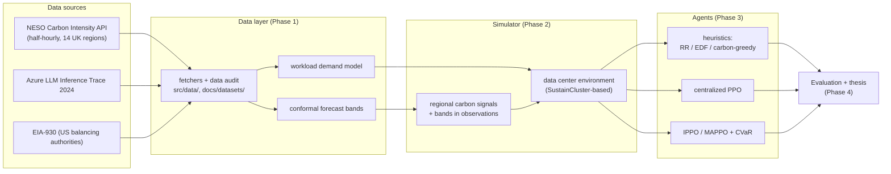
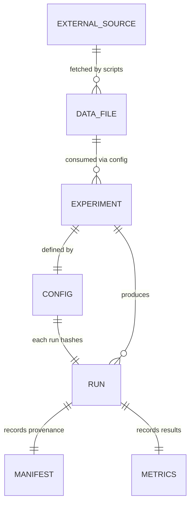
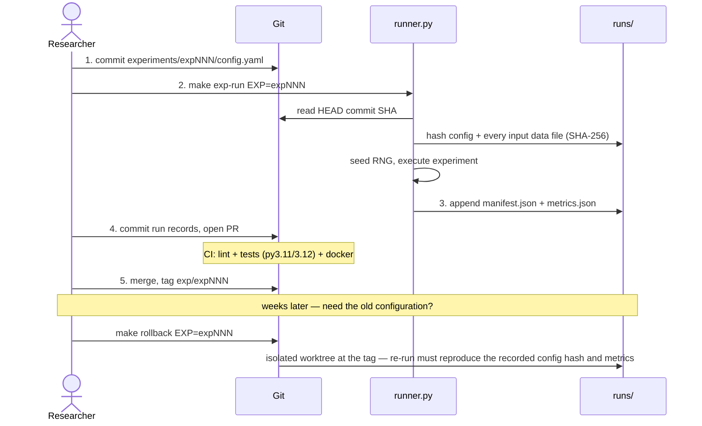
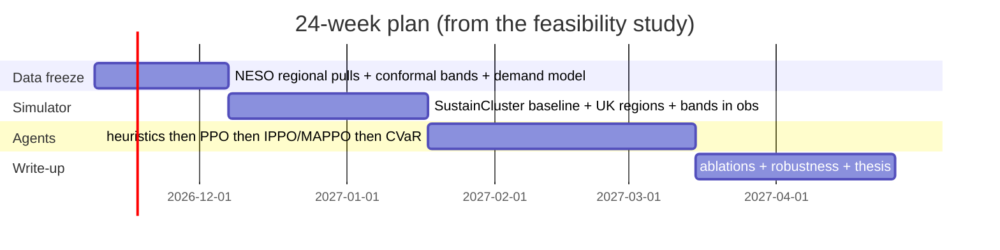

# Carbon-Aware Workload Scheduling Across Geo-Distributed Data Centers

Uncertainty-aware decentralized multi-agent reinforcement learning (MARL)
for scheduling GPU/LLM workloads across data centers in different grid
regions, so that carbon emissions go down without blowing deadlines.
B.Tech major project.

[](https://github.com/ayush528/carbon-aware-marl-scheduling/actions/workflows/ci.yml)

## Why this is hard (and what we're doing about it)

We surveyed the major public workload traces (Azure, Alibaba, Google Borg,
Bitbrains and more — 29 trace families in total). The finding that shapes
the whole project: **none of them officially maps workloads to a real grid
region.** The strongest signal any publisher ships is a timezone hint, and
that is disappearing over time. So a scheduler that "knows" the carbon
intensity of the region its data center sits in is, today, built on an
assumption nobody can verify from public data.

Our contribution is to make that uncertainty a first-class input instead of
sweeping it under the rug:

1. Treat the UK as ground truth (its NESO API publishes half-hourly,
   region-level carbon intensity, forecast *and* actual).
2. Put **calibrated forecast bands** (conformal prediction) on the carbon
   signal, from the observed forecast-vs-actual error.
3. Schedule with **decentralized MARL** that consumes those bands, with a
   risk term (CVaR) on SLA violations.
4. Claim only relative improvements under identical demand.

The full feasibility study, 30-paper survey and data audit are in
[`docs/research/`](docs/research/findings-and-plan.md).

## Architecture



Each agent level is only added after the previous one is beaten or matched —
every run lands in the experiment record (below), so the progression is
auditable.

## Data storage

There is no database server: the store is **flat files + git**, chosen so
that every number in the thesis is traceable to a committed, hashed record.



| Piece | Where | What it holds |
|---|---|---|
| Dataset catalog | `docs/datasets/DATASETS.md` | source URLs, licenses, audit status of every dataset |
| Raw data | `docs/datasets/data-audit/downloads/` | small evidence files committed; large CSVs refetched via `make data-fetch` |
| Experiment config | `experiments/<id>/config.yaml` | committed **before** running; defines seed, inputs, hypothesis |
| Run records | `experiments/<id>/runs/<timestamp>-<hash>/` | `manifest.json` (git SHA, config SHA-256, data SHA-256s, seed) + `metrics.json` |
| Registry | `experiments/registry.yaml` | status of every experiment and its rollback tag |

Large raw files stay out of git (50 MB rule, enforced by review); everything
derived from them is reproducible from the fetch scripts.

## Experiment lifecycle

Every experiment is versioned and can be reproduced or rolled back with one
command. Same commit + same config + same data files ⇒ same metrics.



The tag is the rollback point; rollback never touches the current tree.

## Roadmap



| Phase | Exit test |
|---|---|
| 1. Data freeze | forecast bands hit target coverage on a held-out month |
| 2. Simulator | baseline reproduced; carbon accounting matches GB actuals |
| 3. Agents | each level beats or matches the previous |
| 4. Evaluate & write | claims stay inside the EuroSys-2024 envelope; assumptions table complete |

## Getting started

```bash
make setup          # .venv + pinned dependencies
make test           # unit tests (the same suite CI runs)
make exp-run EXP=exp001-uk-carbon-baseline
```

With Docker instead (no local Python needed):

```bash
make docker-test
EXP=exp001-uk-carbon-baseline docker compose run --rm exp
```

## Project layout

```
src/carbon_scheduling/   library code (data loaders, experiment runner)
experiments/             versioned experiments + registry
tests/                   unit tests (CI gate for every PR)
scripts/                 setup, experiment, rollback, data-fetch helpers
docker/                  reproducible environment (pinned python image)
docs/
  research/              feasibility report, survey notes, project plan
  datasets/              dataset catalog + data audit evidence
  deliverables/          proposal deck, dataset comparison
  notes/                 TODO, decision log
```

All repeatable operations are `make` targets — run `make help` for the list.
